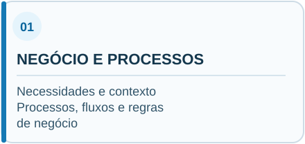
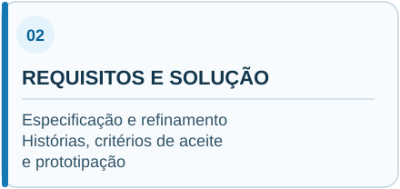
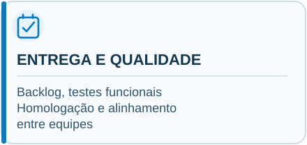

  

 

### Análise de Negócios · Engenharia de Requisitos · Governança de TI

**Da compreensão do negócio à validação das soluções.**

&nbsp;&nbsp;

---

## Apresentação profissional

Sou **Analista de Negócios e Requisitos**, com experiência em levantamento, documentação, refinamento, homologação e acompanhamento do desenvolvimento de sistemas.

Atuo na conexão entre as necessidades das áreas de negócio e as soluções tecnológicas, com foco na clareza dos requisitos, rastreabilidade das decisões e melhoria contínua dos processos.

Atualmente, participo de iniciativas de desenvolvimento e modernização de sistemas na **Secretaria de Estado da Saúde de São Paulo**.

## Áreas de atuação

Atuação integrada em todo o ciclo de análise, da compreensão do negócio à validação das entregas.

  
  
  

<strong>Ver competências detalhadas</strong>

### 01 | Negócio e processos
- Levantamento de necessidades
- Mapeamento e análise de processos
- Regras de negócio e casos de uso
- Análise de fluxos e perfis de acesso

### 02 | Requisitos e solução
- Especificação e refinamento de requisitos
- Histórias de usuário e critérios de aceite
- Prototipação e validação funcional
- Documentação e rastreabilidade

### 03 | Entrega e qualidade
- Gestão e priorização de backlog
- Testes funcionais e homologação
- Alinhamento entre negócio e equipe técnica
- Práticas e metodologias ágeis

## Experiência em projetos

<table>
<tr>
<td width="50%" valign="top">

### SIGES
**Gestão e Prestação de Contas**

Atuação na análise de requisitos, definição de regras de negócio, mapeamento de fluxos e validação funcional de sistema relacionado à prestação de contas no contexto do **AUDESP Fase V**, do TCE-SP.

**Ênfase:** fluxos de análise, perfis de acesso, acompanhamento de status, relatórios e indicadores gerenciais.

</td>
<td width="50%" valign="top">

### Remédio SP
**Soluções Digitais em Saúde**

Atuação em análise de negócios e requisitos, prototipação, revisão de regras de negócio e validação funcional de fluxos relacionados à gestão de solicitações e medicamentos.

**Ênfase:** processos de negócio, critérios de validação, experiência do usuário e evolução funcional.

</td>
</tr>
</table>

*As experiências institucionais são apresentadas de forma descritiva, sem exposição de código, documentos internos ou informações restritas.*

## Estudo de caso

### Levantamento de Requisitos para Sistema de Gestão de Padaria

Esta experiência representa meu início na área de análise de requisitos.

Atuei no levantamento das necessidades para um sistema de gestão de padaria, com foco na compreensão dos processos do negócio, identificação das necessidades dos usuários e documentação dos requisitos para apoiar a definição da solução.

O estudo de caso é uma reconstrução resumida da minha atuação, sem divulgar materiais confidenciais ou pertencentes ao projeto original.

## Formação acadêmica

**Pós-graduação em Governança de Tecnologia da Informação**

## Contato profissional

&nbsp;&nbsp;

---

<strong>Confidencialidade:</strong> este portfólio não publica dados de sistemas institucionais, documentos internos, informações pessoais de usuários ou conteúdo restrito de projetos profissionais.
